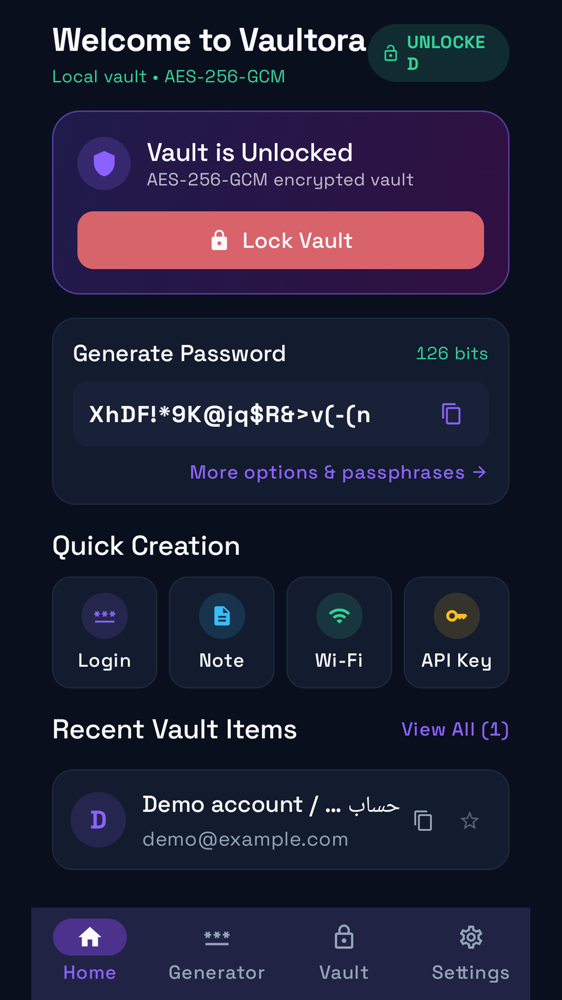
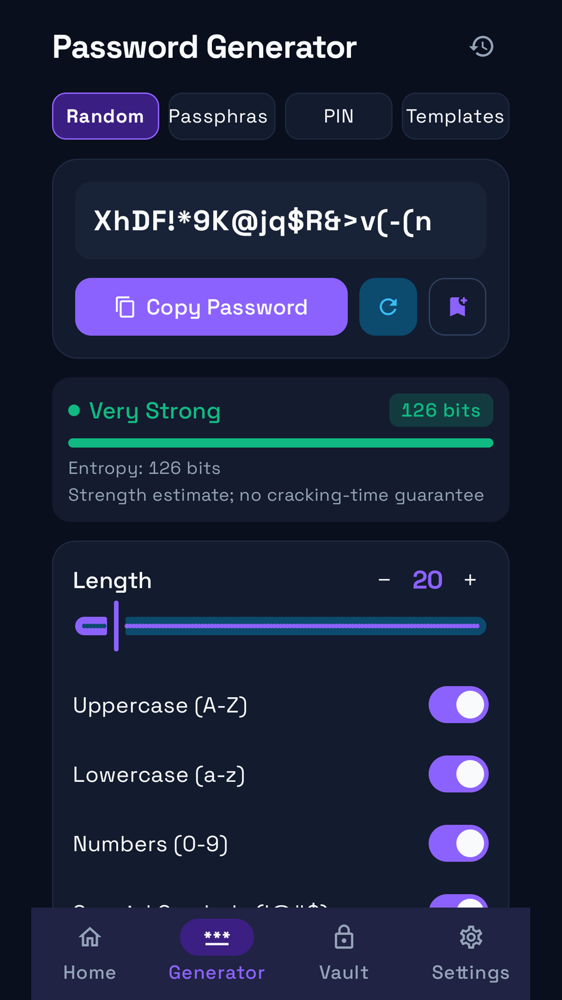
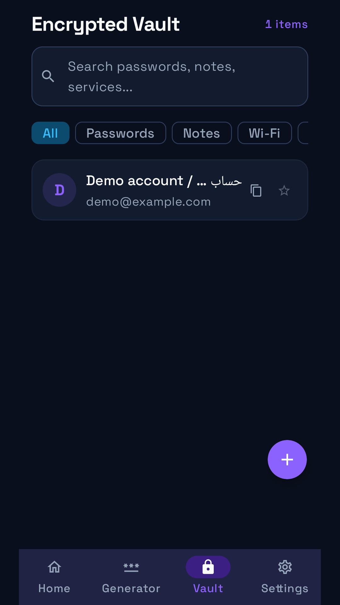
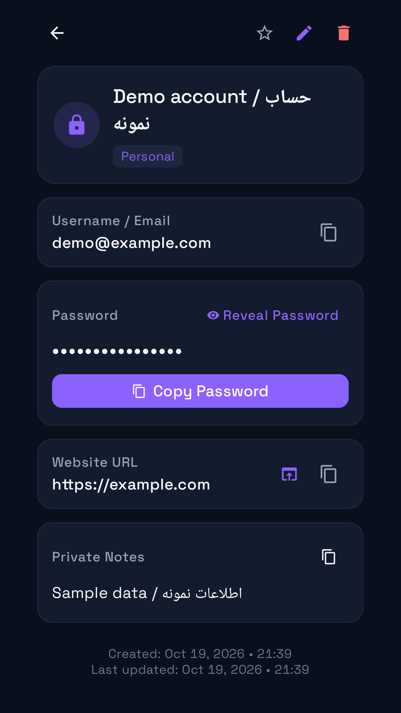
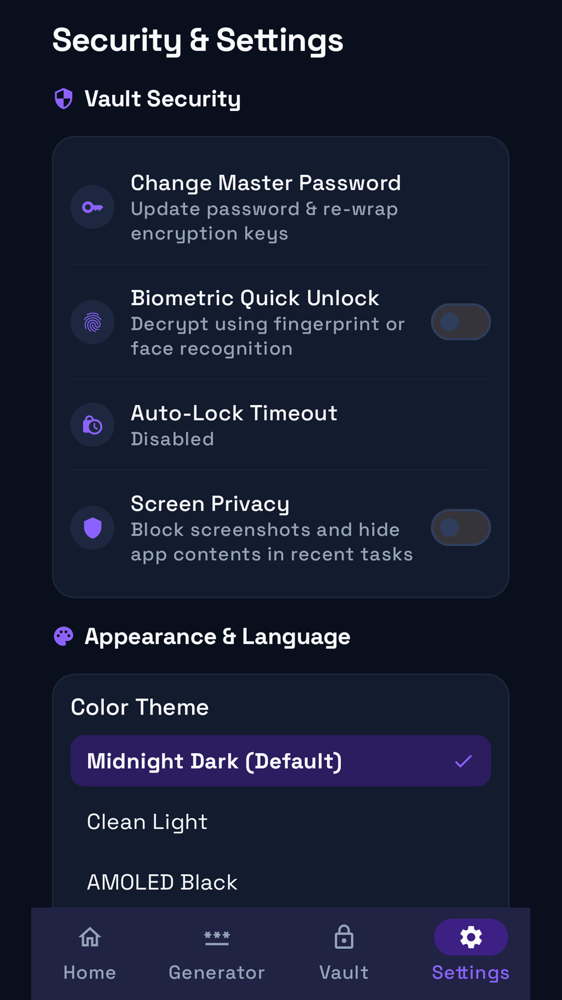
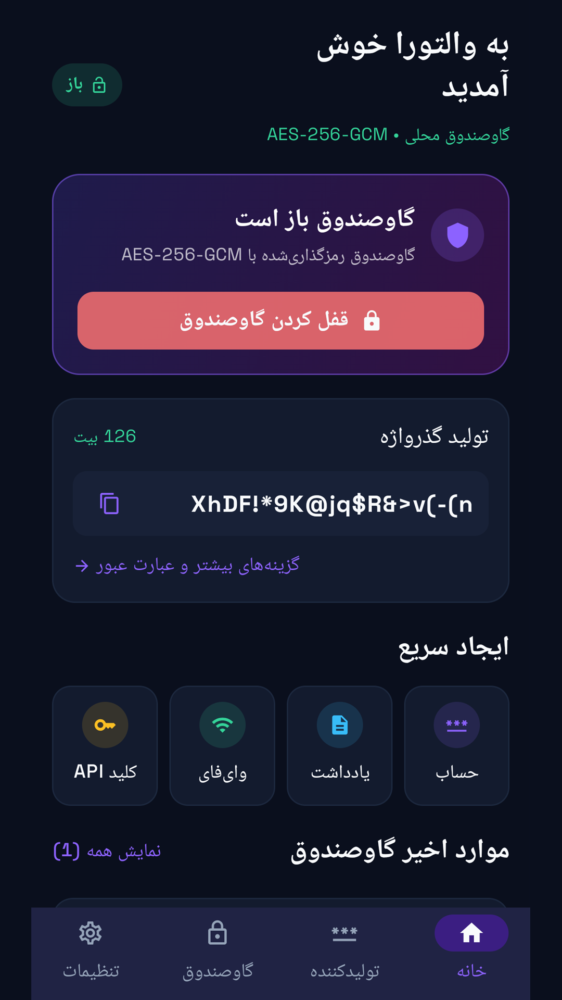
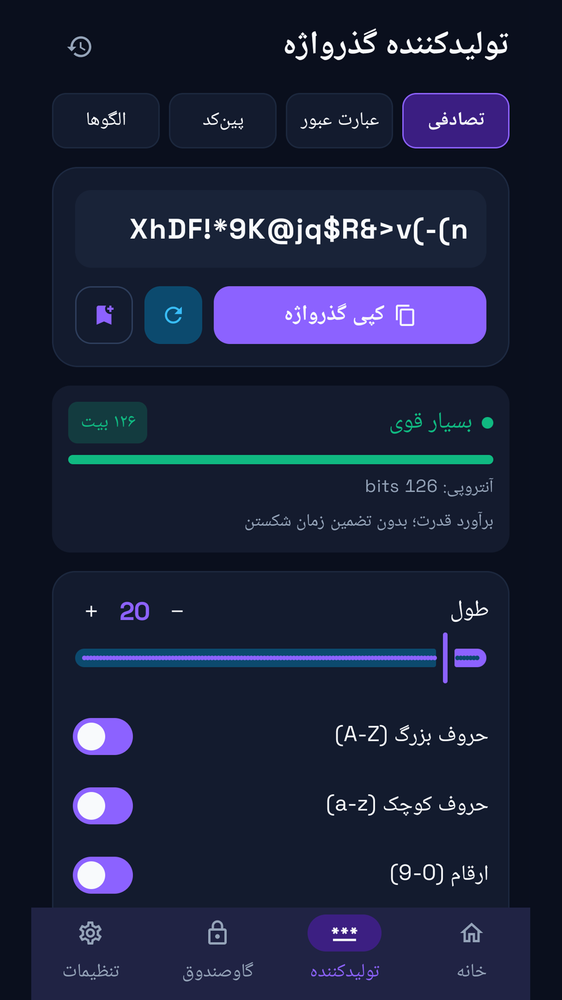
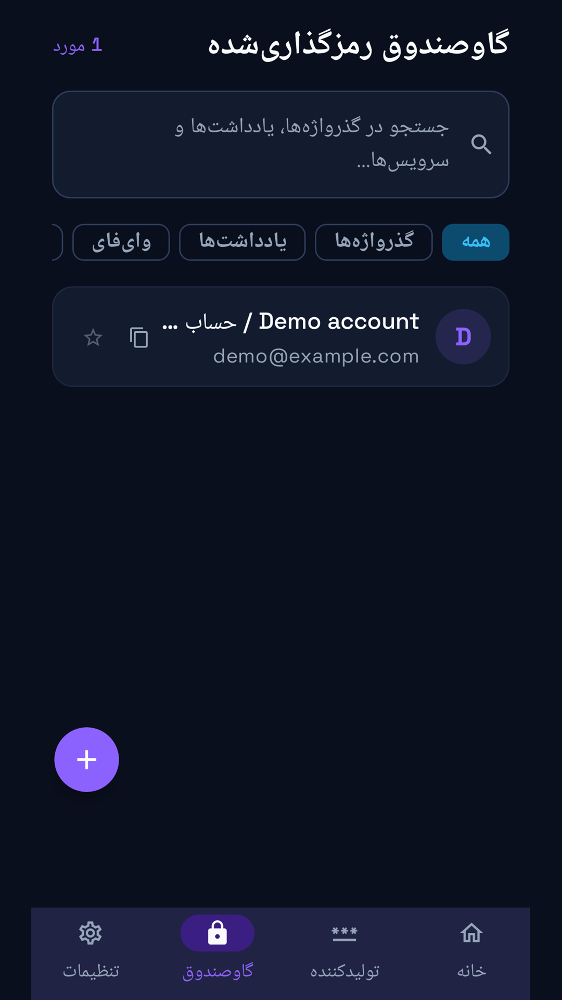
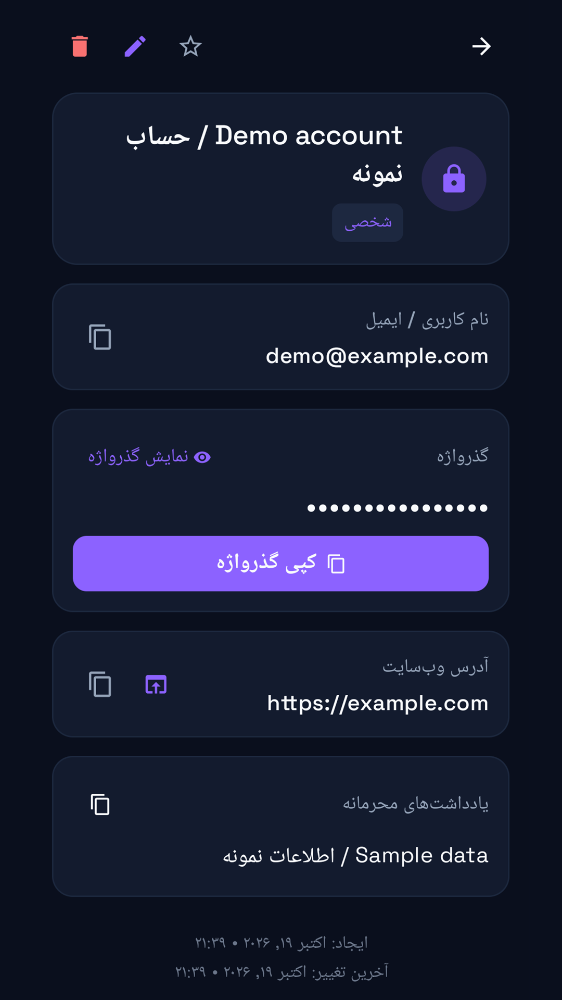
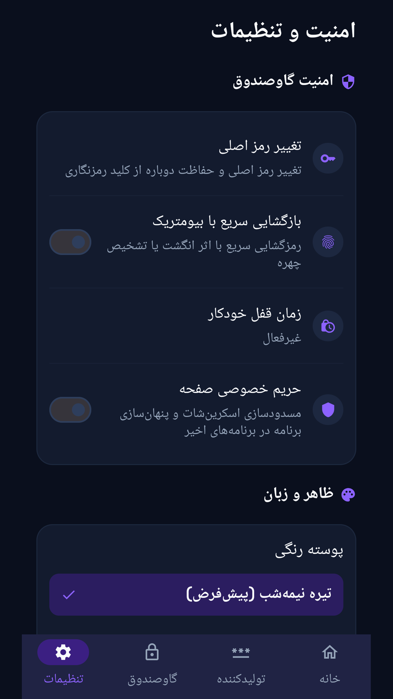

# Vaultora | والتورا

[دریافت آخرین نسخه / Download latest](https://github.com/cinaasadpour-hash/vaultora/releases/latest)

## فارسی

گاوصندوق محلی رمزها با مولد رمز، بازکردن با اثرانگشت و پشتیبان رمزگذاری‌شده.

### شروع کار

یک رمز اصلی حداقل ۱۲ نویسه‌ای بسازید و آن را نگه دارید. موارد را در گاوصندوق ذخیره کنید. در تنظیمات می‌توانید اثرانگشت و قفل خودکار را فعال کنید و پشتیبان رمزدار با رمز جدا بگیرید. رمز فراموش‌شده قابل بازیابی نیست؛ فایل پشتیبان و رمز آن را امن نگه دارید.

### تبلیغات

فقط بنر همسان در تنظیمات؛ بدون تبلیغ در قفل، مولد، فهرست و جزئیات رمزها. نبود تبلیغ مانع استفاده از برنامه نمی‌شود.

## English

A local encrypted password vault with a password generator, biometric unlock and encrypted backups.

### Getting started

Create and retain a master password of at least 12 characters. Save items in the vault. Settings provides biometric unlock, auto-lock and encrypted file backups with a separate password. Forgotten passwords cannot be recovered; keep your backup file and password safe.

### Advertising

Only a native banner in Settings; no ads on the lock screen, generator, vault list or item details. An unavailable ad does not block ordinary use.

## Download and updates | دریافت و به‌روزرسانی

Android APK, version **1.0.5**. Package: `com.sinatools.vaultora`.
For updates of `com.sinatools.vaultora`, install over the same package. The previous `com.aistudio.vaultora.secapp` app is a separate Android application: export an encrypted backup from it and import that backup into this version before removing the old app. Data does not transfer automatically.

نسخه‌های دارای بستهٔ `com.sinatools.vaultora` روی یکدیگر به‌روز می‌شوند. نسخهٔ قدیمی با بستهٔ `com.aistudio.vaultora.secapp` برنامه‌ای جداست؛ ابتدا از آن پشتیبان رمزگذاری‌شده بگیرید و در نسخهٔ جدید وارد کنید. تنها پس از اطمینان از انتقال اطلاعات، نسخهٔ قدیمی را حذف کنید.

[Privacy / حریم خصوصی](PRIVACY.md)

This repository distributes the signed app and user guide. Private signing keys and local build credentials are not published.

<!-- STORE-GALLERY -->

## Screenshots | تصاویر برنامه

App screens in English and Persian; sample content is used where needed.

### English

### فارسی

