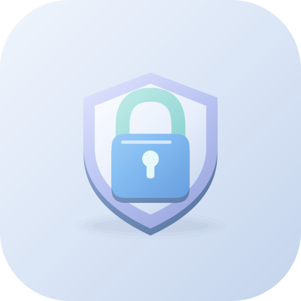

# Vaultora | والتورا

[دریافت آخرین نسخه / Download latest](https://github.com/cinaasadpour-hash/vaultora/releases/latest)

## فارسی

گاوصندوق محلی رمزها با مولد رمز، بازکردن با اثرانگشت و پشتیبان رمزگذاری‌شده.

### شروع کار

یک رمز اصلی حداقل ۱۲ نویسه‌ای بسازید و آن را نگه دارید. موارد را در گاوصندوق ذخیره کنید. در تنظیمات می‌توانید اثرانگشت و قفل خودکار را فعال کنید و پشتیبان رمزدار با رمز جدا بگیرید. رمز فراموش‌شده قابل بازیابی نیست؛ فایل پشتیبان و رمز آن را امن نگه دارید.

### تبلیغات

فقط بنر همسان در تنظیمات؛ بدون تبلیغ در قفل، مولد، فهرست و جزئیات رمزها. نبود تبلیغ مانع استفاده از برنامه نمی‌شود.

## English

A local encrypted password vault with a password generator, biometric unlock and encrypted backups.

### Getting started

Create and retain a master password of at least 12 characters. Save items in the vault. Settings provides biometric unlock, auto-lock and encrypted file backups with a separate password. Forgotten passwords cannot be recovered; keep your backup file and password safe.

### Advertising

Only a native banner in Settings; no ads on the lock screen, generator, vault list or item details. An unavailable ad does not block ordinary use.

## Download and updates | دریافت و به‌روزرسانی

Android APK, version **1.0.2**. Package: `com.aistudio.vaultora.secapp`.
For updates, install over the existing app to preserve its local data. Do not uninstall first.

برای حفظ اطلاعات، نسخه جدید را روی نسخه قبلی نصب کنید؛ ابتدا برنامه را حذف نکنید.

[Privacy / حریم خصوصی](PRIVACY.md)

This repository distributes the signed app and user guide. Private signing keys and local build credentials are not published.
